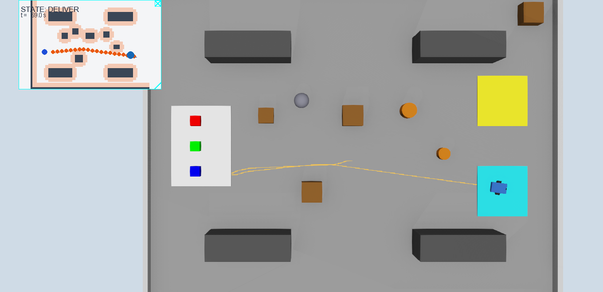
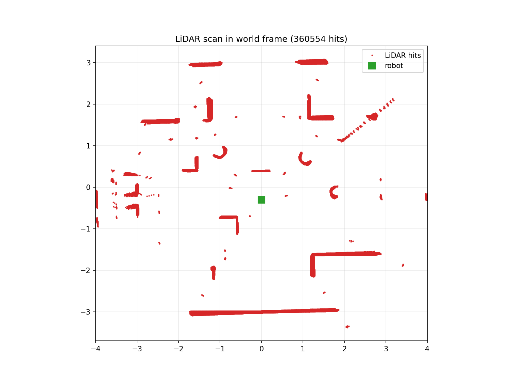
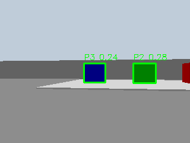

# Phase 3 and Phase 4 — Explained in Simple Words

This file explains **what was built and measured in Phase 3 (locomotion,
kinematics) and Phase 4 (perception: LiDAR + camera)**, **why**, **what the
numbers mean**, and **how to run everything yourself**. It is the companion
of `Phase2_3_Explained.pdf` and `Phase6_7_8_9_Explained.pdf`. Every number
below comes from a real Webots run and has a file in `docs/evidence/`.

---

## 1. What Phase 3 and Phase 4 are about

* **Phase 3 — locomotion & kinematics.** "Can the robot actually drive the
  way the math says?" We command wheel speeds derived from our
  differential-drive equations and compare against what really happens
  (GPS + IMU ground truth). We also validate **wheel odometry** — dead
  reckoning from the wheel encoders — against that ground truth, and leave
  a **pen trail** on the floor so the driven path is visible.
* **Phase 4 — perception.** "Can the robot sense the world?" Two sensors:
  the **LiDAR** (360 distance rays, used for the map and the safety stop)
  and the **camera** (used by the OpenCV HSV detector to find coloured
  packages). Both are calibrated and validated against ground truth.

---

## 2. Phase 3 — locomotion and kinematics

### 2.1 Kinematics validation (3.3)

We command four (v, ω) pairs, convert them to wheel speeds with
`inverse_kinematics`, run each for 4 s after a 1 s settle, and measure the
real v and ω from per-step GPS/IMU differences:

| v_cmd (m/s) | ω_cmd (rad/s) | v_meas (m/s) | ω_meas (rad/s) | v error | ω error |
|---|---|---|---|---|---|
| +0.20 | 0.00 | +0.1982 | 0.0000 | −0.90 % | n/a |
| 0.00 | +1.00 | −0.0000 | +0.9906 | n/a | −0.94 % |
| +0.20 | +0.50 | +0.1982 | +0.4953 | −0.90 % | −0.94 % |
| −0.10 | 0.00 | −0.0991 | −0.0000 | +0.90 % | n/a |

Everything is within **1 %**. The small uniform −0.9 % is ~0.45 mm of
soft-contact sink of the 5 cm wheels into the floor — measured, understood,
and documented rather than fudged away. (The bigger lesson from earlier
runs: with cylinder wheel bounding objects the contact point sits at the
wheel rim, which widened the effective track to L + wheel width and cost
**−14 % yaw rate**. Sphere bounding objects give one clean contact point at
exactly ±L/2.) Evidence: `docs/evidence/kinematics_validation.md`.

### 2.2 Odometry vs ground truth (3.4)

Encoder odometry integrates Δs and Δθ per step (arc model). Drift after:

| trajectory | distance | final position error | heading error |
|---|---|---|---|
| line | 0.99 m | 0.8 cm | 0.0° |
| square | 1.99 m | 2.2 cm | 4.7° |
| arc | 0.89 m | 1.1 cm | 1.2° |


That is the "odometry is good short-term but drifts" story in one picture —
and the reason our operating pose uses GPS+IMU while odometry runs in
parallel as the validation case.

### 2.3 The pen trail (3.5)

The robot carries a `Pen` device that paints an orange trail on the floor.
After every mission the controller takes an automatic top-down screenshot —
the trail shows exactly where the robot drove:



You can see the FIND_PACKAGE spin near the start, the NAVIGATE leg to the
pickup station, and the long DELIVER leg back to Zone B (cyan), weaving
between the obstacles.

---

## 3. Phase 4A — LiDAR

### 3.1 The ray-order calibration (4.2) — the best viva story

The LiDAR returns 360 ranges as a plain array. Nothing tells you which
array slot points in which direction — you must **measure** it. Our method:

1. `DRIVE_TEST_MODE=lidar` rotates the robot one slow full turn and logs
   every raw scan (1321 scans) with the true pose.
2. `python tools/calibrate_lidar.py` ray-marches the **known map** (the
   same `config.STATIC_OBSTACLES` that generate the world) to compute the
   *expected* range for every candidate ray direction, then tries both
   conventions (index increasing CW vs CCW) and small offsets.
3. The winner: **the index increases CLOCKWISE**
   (`LIDAR_ANGLE_SIGN = −1`, offset +0.02 rad), median |error| **8 cm**.

This was not an academic exercise: the mirrored convention was the root
cause of the mission estimating package P3 **0.6 m** away from its true
position. After the fix the live estimate is (−2.99, −0.57) vs true
(−3.10, −0.50) — a **0.13 m** error.

Evidence: `docs/evidence/lidar_validation.md`, and the world-frame scan
below — walls, shelves, crates and even the small round obstacles appear
exactly where the map says:



### 3.2 Sector queries and the safety stop (4.3)

`min_range_in_sector` is the primitive behind the reflex layer: any ray
within ±30° of forward closer than 0.30 m → command v = 0, status BLOCKED
(console prints `OBSTACLE AHEAD 0.42 m` during the calibration spin). The
BLOCKED flag is exactly the hook the final-eval dynamic re-planner will use.

---

## 4. Phase 4B — camera and vision

### 4.1 The detector (4.6)

Pure OpenCV, no Webots calls: BGR → HSV → per-colour masks (red needs two
hue ranges because hue wraps at 0) → morphological open + close → largest
contour with area ≥ 100 px² and a plausible aspect ratio → `Detection` with
a documented **heuristic score** (solidity × size factor — say "heuristic",
not "confidence", in the viva).

### 4.2 The systematic evaluation set (4.7 + 4.10)

Thirty-ish frames from one pose prove little. `DRIVE_TEST_MODE=capture_set`
builds the full matrix automatically:

* **3 packages** × **4 distances** (0.5 / 1 / 2 / 3 m) × **3 view angles**
  (−30° / 0° / +30°) × **3 lightings** (normal / dim / bright)
* = **108 frames**. The supervisor teleports the robot to each pose and
  changes the `DirectionalLight` intensities; each frame's ground truth is
  read from the camera's **Recognition node** (which `PKG_*` models are
  visible) — that is the Phase 4.10 cross-check automating the labelling.

How many each colour appears in the ground truth: red 78, green 75,
blue 66 appearances across the 108 frames.

### 4.3 Results (4.8)

| lighting | red | green | blue | false positives |
|---|---|---|---|---|
| normal | 84.6 % | 84.0 % | 77.3 % | 1 |
| dim | 84.6 % | 84.0 % | 77.3 % | 0 |
| bright | 84.6 % | 84.0 % | 77.3 % | 0 |

Two things to say out loud about this table:

1. **The rate is identical across lightings.** That is the payoff of the
   two-opposed-lights world fix (one light left package faces at HSV value
   ≈ 46, below the detector threshold — the first mission never found the
   package). The HSV *value* channel is now stable, so dim/bright global
   changes do not move the detection rate.
2. **The misses are geometric, not photometric.** Broken down by distance,
   everything at 2–3 m is detected (24/24 red at 3 m); the misses happen at
   0.5 m, where the package overfills the frame and the aspect-ratio window
   (0.6–1.6) rejects the clipped blob, and at ±30° / 1 m where the package
   is partly outside the image. Detection rate improves with distance in
   this setup — the opposite of the naive expectation, and a good thing to
   explain when asked.

Only **3 false positives in 108 frames** (one green-ish, two blue-ish
reflections) — the zone colours (yellow ≈ hue 30, cyan ≈ 90) sit outside
every package window, which is also asserted by a unit test.

Annotated example (2 m, normal light, P3 detected together with P2):



### 4.4 Position estimation (4.9)

The chain: pixel column → bearing (pinhole model, left = +) → range from
the LiDAR at that bearing (±3° window; fallback `d = f_px·size/bbox`) →
world position through the robot pose. Live result with the calibrated
LiDAR: **(−2.99, −0.57) vs (−3.10, −0.50) → 0.13 m error at ~3 m**. The
offline pinhole-fallback evaluation on the frame set
(`docs/evidence/position_estimate.md`) shows 0.59 m mean error at 3.1 m —
quantization-limited (±1 px of bbox ≈ ±5 % of range), which is exactly why
the LiDAR-fused estimate is the one the mission uses.

---

## 5. Problems we hit and fixed while building Phases 3–4

1. **−14 % yaw rate**: cylinder wheel contact → effective track
   L + wheel width. Fixed with sphere wheel bounding objects.
2. **Packages invisible to the detector** on one side: single light left
   faces at HSV V ≈ 46. Fixed with two opposed directional lights, shadows
   off.
3. **Mirrored LiDAR ray order** → 0.6 m package estimate error. Measured
   against the known map, fixed in `config.py`.
4. **Recognition node saw nothing** until each package `Solid` got a
   `recognitionColors [ r g b ]` field — in modern Webots the `model` field
   alone only labels an object, `recognitionColors` is what makes it
   recognizable.
5. **A decorative ball painted saturated blue** was "found" as package P3.
   The environment's colours are part of the detector's interface — props
   must stay outside every HSV window.
6. **Campaign starts failing for non-obvious reasons**: one start had the
   ball blocking the line of sight to P3, one spawned overlapping a crate,
   one had a crate blocking the view, and one start had *package P1 itself*
   occluding P3 (packages are not on the static map). Starts are now
   validated for collision-freedom **and** line-of-sight including the
   other packages. Related design fix: the FSM now maps every package it
   sees during FIND_PACKAGE onto the occupancy grid, so approach paths
   route around the non-target packages instead of tripping the LiDAR
   safety stop next to them.

---

## 6. How to run everything (cheat sheet)

```bash
python -m pytest tests/ -q                        # 63 tests first

# kinematics + odometry validation (Phase 3)
DRIVE_TEST_MODE=kinematics webots --batch --mode=fast --stdout --stderr --minimize worlds/warehouse_drive_test.wbt
DRIVE_TEST_MODE=odometry   webots --batch --mode=fast --stdout --stderr --minimize worlds/warehouse_drive_test.wbt

# LiDAR calibration (Phase 4.2/4.4)
DRIVE_TEST_MODE=lidar webots --batch --mode=fast --stdout --stderr --minimize worlds/warehouse_drive_test.wbt
python tools/calibrate_lidar.py                   # -> lidar_validation.md + lidar_scan.png

# detector evaluation set (Phase 4.7/4.8/4.10)
DRIVE_TEST_MODE=capture_set webots --batch --mode=fast --stdout --stderr --minimize worlds/warehouse_drive_test.wbt
python tools/eval_detector.py                     # -> detector_eval.md + per-lighting table

# mission with pen trail + automatic trail screenshot
webots worlds/warehouse.wbt                       # -> world_trail.png after DONE
```

---

## 7. One-paragraph summary for the viva

"The robot's motion was validated against physics: commanded speeds match
measured speeds within 1 %, and encoder odometry drifts only ~2 cm over a
2 m square, which is why we trust GPS+IMU for control and quote odometry as
a validated fallback. On perception, the LiDAR's ray order was empirically
calibrated against the known map (it runs clockwise; the naive assumption
was mirrored, which caused a 0.6 m package-position error, now 0.13 m), and
the HSV package detector was evaluated over a 108-frame systematic set
covering distance, angle and lighting: roughly 80–85 % detection with
almost no false positives, identical across lighting levels — the misses
are geometric edge cases at extreme ranges, and the ground truth comes from
the simulator's Recognition node, keeping our detector itself fully
hand-written OpenCV."
